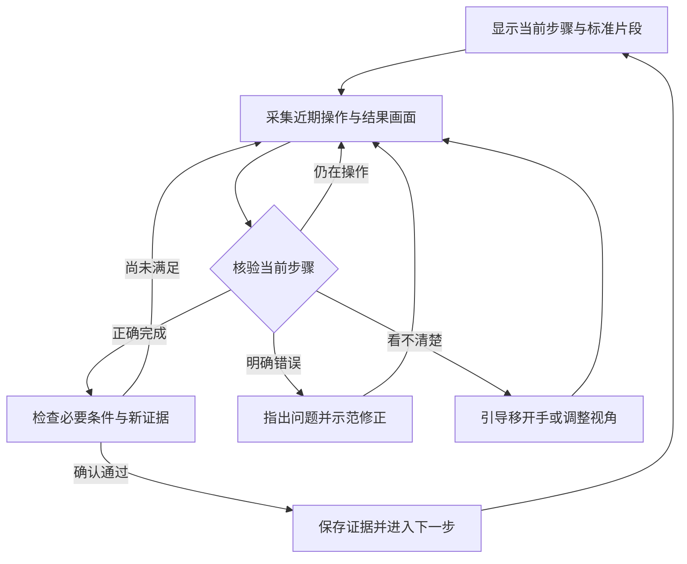

# 工序智传：教学视频生成 SOP 与逐步实时陪练方案

日期：2026-10-13。本文保留调研与拟议设计；第一版核心教学与陪练已实现，
实际功能、启动和验证范围见 [第一版使用说明](SOP_TUTOR_README.md)。
本文的进阶能力与性能目标仍需后续实测。

已确认约束：面向 iCAN 智能教育方向；普通电脑与摄像头；允许调用云端模型；首个实训场景尚未确定。本方案中的帧数、时延和验收阈值是实验起点或建议目标，均不代表现有系统性能。

## 🎯 建议与适用范围

建议将产品发展为“教师备课 + 学员逐步陪练”：教师上传完整教学视频，系统生成带原片段、完成条件和纠错提示的 SOP，教师校对后发布；学员跟随每步教学操作，摄像头采集近期画面，系统核验完成状态，正确后前进，错误时指导修正，证据不足时继续观察。

推荐先使用现有 FastAPI、Vue、SOP 版本管理与 Qwen 接口，增加独立的在线教学会话和步骤状态机。第一版采用短窗口多图核验，视觉运算放在云端，本地负责采集、质量检查、状态控制和证据保存。

一段正确视频能提供步骤草稿与示范，但无法单独证明所有允许的顺序、错误类型和不可见质量要求。教师应确认一次步骤边界、完成标准和必要的前置关系。这里的“自动生成完整 SOP”指覆盖视频中有证据的教学过程，不能通过补写猜测填满流程。

本次查到的资源可以分别支持视频理解、视频分段、在线采集和工序核验；没有验证到能够仅凭一段任意教学视频，就稳定完成所有场景下实时纠错与自动放行的即用系统。

## 🔧 首个演示场景

建议选择“职业实训中的桌面机械模块装配”，用大型、颜色或外形易区分的零件组成模块小车或简易支架。这个建议基于可观察性和现有项目适配成本，尚需实际视频验证。

| 场景 | 可展示的教学内容 | 视觉上的主要难点 | 建议 |
| --- | --- | --- | --- |
| 模块小车或机械支架装配 | 零件选择、结构关系、必要顺序、装配自检 | 遮挡、相近部件、方向 | 首选；先限定到 5–6 步 |
| 彩色插接件或磁吸结构装配 | 顺序、空间关系、纠错练习 | 教学深度需要课程目标支撑 | 技术预验证备选 |
| 计算机内部硬件安装 | 部件认知与安装流程 | 接口细节、卡扣遮挡 | 稳定后再扩展 |
| 接线、焊接、细小销钉或扭矩操作 | 更接近专业工种 | 关键质量常不可见或需要量具 | 不作为首个纯视觉自动放行案例 |

可以设计六步：摆正底板、安装前支架、安装后支架、安装左轮组、安装右轮组、安装顶盖并检查外观。具体步骤必须以实际器材和教师确认的工艺为准；左右轮组如果允许换序，不能因示范视频先装左侧就强制相同顺序。

机位采用固定俯斜视角，完整覆盖工作区。完成一个步骤后自然移开手，使状态可见；细节不清楚时引导展示近景。建议准备三种清晰错误：拿错零件、装反方向、遗漏必要部件，再准备一种遮挡情况。不要把“外观看起来到位”延伸成扭矩、强度或内部连接质量已经合格。

## 🔍 开源与公开研究参考

以下信息来自本次查看的项目官方仓库、文档和论文；“适合本项目的用途”是本方案的工程判断。代码、模型权重和数据许可需要分别看待。

| 项目与来源 | 已公开的能力 | 适合本项目的用途 | 接入边界 |
| --- | --- | --- | --- |
| [NVIDIA SOP Monitoring Blueprints](https://github.com/NVIDIA/sop-monitoring-blueprints)[^1] | 标注、SOP 模型微调、时序模型与实时监测；代码 Apache-2.0，文档 CC-BY-4.0 | 最接近整体需求；参考动作分段、VLM 核验及事件输出架构 | 官方推理方案包含 DeepStream、Triton、vLLM，并需要相应模型；不适合普通电脑直接照搬整套 |
| [NVIDIA Live VLM WebUI](https://github.com/NVIDIA-AI-IOT/live-vlm-webui)[^2] | WebRTC 摄像头、异步视觉分析、兼容接口和云端后端；Apache-2.0 | 参考实时采集、请求节奏和画面反馈 | 自身不提供教学 SOP 的完成门槛；Windows 原生运行仍需额外设置 |
| [Qwen3-VL](https://github.com/QwenLM/Qwen3-VL)[^3] | 多图与视频理解，支持带采样信息的视频输入；仓库 Apache-2.0 | 理解教学片段、对照当前步骤和参考图核验 | 采用云端视觉接口时，本机无需部署模型；云端型号、能力和服务条款须以实际接口为准 |
| [IndustReal](https://github.com/TimSchoonbeek/IndustReal)[^4] | 工序步骤识别、动作识别、装配状态检测代码及数据；仓库 Apache-2.0 | 与现有模块装配方向一致；学习“完成是否正确”的定义、错误类别和评测方式 | 研究基线需要场景适配；原始第一视角数据不能替代本项目固定机位测试 |
| [Differentiable Task Graph Learning](https://github.com/fpv-iplab/Differentiable-Task-Graph-Learning)[^5] | 任务依赖图学习与在线错误检测的研究代码 | 参考必要顺序、漏步与允许换序的表达 | 首版采用教师确认的依赖图；本次未核实明确代码许可，不将其列为可直接复制的依赖 |
| [faster-whisper](https://github.com/SYSTRAN/faster-whisper)[^6] | 语音转写，支持 CPU INT8 | 转写教学视频旁白，辅助步骤边界和名称 | 需要抽查术语与时间戳；选小模型或离线慢处理，实际速度待本机测量 |
| [FunASR](https://github.com/modelscope/FunASR)[^7] | 语音识别、VAD 等；工具包 MIT | 中文教学旁白识别的候选方案 | 时间戳支持因模型和调用路径不同；模型另有许可，不只看工具包 MIT |
| [PySceneDetect](https://github.com/Breakthrough/PySceneDetect)[^8] | 镜头切换与转场检测；BSD-3-Clause | 辅助定位剪辑边界和组织抽帧 | 镜头边界不等于操作步骤边界；固定机位连续操作仍需语义分段 |

另外查到 [DoubleH10/Video-SOP](https://github.com/DoubleH10/Video-SOP)，它主要针对屏幕录制，README 的许可标记为“Private - TCS Internal Use”。因此本方案不把它当作可直接复用的开源项目。[^9]

## 📥 从完整教学视频生成可教学、可核验的 SOP

建议将离线编译过程扩展为六个阶段：

1. **提取全片信息。** 获取视频时长、音轨、讲解转写及时间戳；按窗口覆盖全片，并检测剪辑边界。无旁白时仍进行视觉分析。
2. **生成候选步骤。** 以带重叠的短片段或有序帧组分析“对象发生了什么变化”，输出动作、开始结束时间、前后状态和来源证据。窗口长度随动作时长调整。
3. **合并与细化边界。** 合并跨窗口的同一动作、剔除重复示范，把大而空泛的步骤拆成可观察的小任务；必要时重新查看边界附近的片段。
4. **生成教学卡片与核验条件。** 每步关联原视频片段、讲解、注意事项、前置状态、完成状态和常见错误。参数只采用视频讲解或手册明确提供的内容。
5. **检查完整性。** 把全片时间段映射为步骤、讲解、重复或其他内容；未解释的长时间区间返回复查，检查“装配后展示”和最后自检有无遗漏。
6. **教师确认发布。** 在现有 SOP 编辑器中校对分段、条件与依赖关系。校对后的版本作为教学与核验的固定依据。

语音转写可从 faster-whisper 或 FunASR 中择一；PySceneDetect 仅辅助切镜头；Qwen 负责图像与步骤语义。相关能力见上表官方来源。[^3][^6][^7][^8]

每一步至少应存储以下内容：

| 信息 | 示例 | 对教学或识别的作用 |
| --- | --- | --- |
| 教学目标与说明 | 将前支架装入底板指定槽位 | 告诉学员要做什么以及为什么 |
| 标准片段与参考图 | 原视频起止时间、操作前后画面 | 提供示范及可追溯证据 |
| 前置条件 | 底板方向正确，前槽位可见 | 确保当前步骤可以执行 |
| 必须完成的条件 | 支架在指定槽位，朝向与参考一致 | 决定能否前进 |
| 典型错误 | 错槽位、支架装反、零件不符 | 生成针对性的纠错说明 |
| 不可观察条件 | 连接强度或内部卡接情况 | 要求补充视角、人工或传感器确认 |
| 合法后继 | 下一步集合及必要依赖 | 允许合理换序，识别真正的漏步 |

一段示范视频中的出现顺序只能先作为候选顺序。必要依赖、允许替代工具、允许换序与可选步骤都需要教师确认。

## 🔄 在线逐步核验与教学反馈



最后一步确认通过后结束本次练习，生成教学反馈；图中的循环适用于仍有未完成步骤的情况。

建议浏览器维持流畅预览，本地以约 1–2 帧/秒采样，保留最近 4–8 秒缓冲。稳定状态、局部变化或学员点击“检查这一步”触发核验；每次只选择 4–8 张近期画面，并携带采集时间、当前步骤、必要前置条件及标准参考图。快速瞬态动作需要加密采样或改用短视频输入。以上均为待调参的初始方案。

官方 Qwen 视觉接口支持图像和视频输入，但不能把某个开源模型的本地输入格式直接当成所有云端兼容接口都支持的格式。实施时应对选用端点验证多图、视频、结构化输出和时延；不支持视频时使用带显式时间戳的有序多图。[^3][^10]

云端输出限定为结构化观察，例如当前操作、可见完成条件、违反条件、证据帧编号，以及 `in_progress / completed / error / uncertain`。服务端核验字段与证据编号，状态机决定推进。模型文字里说“通过”不能直接触发页面跳转。

自动推进应同时满足：

- 前置步骤成立，当前步骤的必要完成检查均有可见证据。
- 证据来自当前步骤激活后的有效窗口；必要时同时确认前后状态变化。
- 没有明确错误，画面足以支持判定；候选完成状态经更新画面确认。
- 结果对应当前会话、SOP 版本与步骤版本，不能拿上一步延迟返回的结果放行下一步。

连续两次请求成功只是抑制抖动的起点，不等于两个独立正确证据。确认窗口必须包含更新的画面，避免反复发送同一图片增加虚假信心；模型自报置信度也不能代替实际错误样本校准。

每个会话最多保留一个视觉请求在处理；调用期间持续更新本地缓冲，后续请求选最新片段，避免队列越积越长。服务端用步骤版本和幂等键处理重复、过期响应。暂停、断网或超时保持当前步骤，并允许继续观察或人工复核。

第一轮争取在“完成状态清晰可见”后约 3–6 秒给出有效提示，并记录 P50、P95、最大值与超时率。这是体验目标，必须用选定云服务、网络和实际工序测量，尚不能承诺实现。

教学提示采用“发现的问题 → 依据 → 下一步修正动作”：例如“前支架朝向与标准图相反，请将开口转向底板前侧”。尚在装配、被手遮住和真正装错分别处理。学生说“完成了”或点击检查只触发核验，不构成通过证据。

## 🧩 对现有源码的改造位置

当前项目已有视频资产、SOP 编译与发布、步骤检查字段、观察事实、证据播放器、报告与权限，可以保留并扩展。当前会话创建 API 接受 `recorded` 与旧的 `manual_offline`，不接受 `live`；内部服务保留的 `live` 值不代表实时功能已接通。

| 位置 | 现状 | 拟议改造 |
| --- | --- | --- |
| [SOP 数据结构](/D:/竞赛记录/ican/工序智传_可部署源码包_2026-08-31/backend/gongxu/sop/schema.py) | 已有 `predecessors`、`completion_checks`、证据引用 | 增加教学说明、前后状态参考、结构化检查 ID、纠错内容和推进策略 |
| [SOP 编译服务](/D:/竞赛记录/ican/工序智传_可部署源码包_2026-08-31/backend/gongxu/sop/service.py) | 全片均匀抽 24 帧，语音与 OCR 输入为空 | 增加带时间戳转写、分层分段、边界复查与全片覆盖检查 |
| [视觉对齐](/D:/竞赛记录/ican/工序智传_可部署源码包_2026-08-31/backend/gongxu/vision/align.py) | 动作匹配时可能在完成检查不足的情况下仍记录 `passed` | 保留历史报告契约；新增专门的完成核验结果与在线推进规则 |
| [评分引擎](/D:/竞赛记录/ican/工序智传_可部署源码包_2026-08-31/backend/gongxu/scoring/engine.py) | 生成整段考评的六维分数与拒判结果 | 用于练习后总结；实时前进由必要完成条件控制 |
| [前端路由](/D:/竞赛记录/ican/工序智传_可部署源码包_2026-08-31/frontend/src/router.ts) | 尚无实时陪练页 | 增加教学练习入口：示范、摄像头、当前步骤与反馈 |
| [SOP 编辑器](/D:/竞赛记录/ican/工序智传_可部署源码包_2026-08-31/frontend/src/views/SopStudioView.vue) | 已能编辑步骤与检查条件 | 增加时间边界、参考图、推进检查和允许换序编辑 |

关键差异是“动作被识别到”与“可以进入下一步”。例如检测到拿起轮组，不代表轮组已经安装到正确轴位。现有 `passed` 和总分阈值不能直接作为自动推进条件。

建议新增 `practice` 领域，包含练习会话、当前步骤状态、观察事件、检查结果和反馈记录，使用现有数据库与权限体系。与预录考评绑定同一 SOP 版本，但分别保存练习纠错次数和独立考评结果。

可先使用以下接口草案：

| 接口 | 作用 |
| --- | --- |
| `POST /api/v1/practice-sessions` | 建立绑定 SOP 版本的练习会话 |
| `POST /api/v1/practice-sessions/{id}/observations` | 提交有序帧与步骤版本，返回任务标识 |
| `GET /api/v1/practice-sessions/{id}/events` | 通过 SSE 推送观察、反馈与步骤变化 |
| `POST /api/v1/practice-sessions/{id}/actions` | 暂停、恢复、请求检查或人工复核 |
| `GET /api/v1/practice-sessions/{id}` | 刷新后恢复当前进度和证据 |

如果使用 HTTP 上传帧与 SSE 返回事件，可以先避免完整 WebRTC 服务端的部署成本；浏览器使用摄像头的权限与安全上下文仍需处理。云端密钥保留在后端，沿用显式外发授权与证据访问控制。自动通过、人工确认和演示回放分别记录来源。

实施前要处理已发现的源码交付缺失：压缩包没有 `backend/gongxu/data`，但资产等核心模块引用它。优先恢复原始模块；如果无法恢复，须根据调用方和现有测试补齐明确契约，不能只建空目录绕过。恢复后再验证 API、SOP 发布和资产流程。

## 🧪 让演示稳定的验证方案

先做单步技术验证，选择一个“明显装对”和一个“明显装错”的部件安装步骤，再加入未完成、遮挡、空桌、旧成品照片、错误后修正和反复拆装等情况。只有完成核验足够可靠，再串联六步，最后接入自动 SOP 编译。

建议采集 3–5 名操作者的开发视频，覆盖正常、选错部件、装反、漏步、允许换序、短暂遮挡、停顿与纠正；之后另留操作者或拍摄批次作冻结测试。邻接视频帧不能随机拆到开发与测试两组。这样得到的是演示场景的证据，不能推广成所有职业工种的准确率。

| 指标 | 如何计算或记录 | 解决的问题 |
| --- | --- | --- |
| SOP 必要步骤召回与证据有效率 | 对照教师确认清单，核对必做步骤及原视频引用 | 自动拆分有无漏步或编造 |
| 错误自动放行率 | 错误或尚未完成的标注核验事件中，自动前进的比例 | 系统会不会教错；按事件统计，避免重复帧稀释 |
| 正确完成识别率 | 正确完成事件中，在预设时间内自动确认的比例 | 学员能不能顺畅走完流程 |
| 反馈时延 | 从完成或明确错误首次可见，到有效反馈的时间；报告 P50/P95 | 真实陪练体验 |
| 拒判与误报 | 分别统计看不清比例、正确操作被提示错误比例 | 区分谨慎与不可用 |
| 纠正后恢复 | 修正错误后恢复推进的次数与耗时 | 反馈是否形成教学闭环 |
| 每次练习成本 | 实际请求次数、输入输出用量与账单 | 云端运行是否可持续 |

研究中的工序步骤识别也把正确完成、误识别和及时性分别评估，可参考 IndustReal 的任务与指标设计。[^4]

初始开发门槛可设为：演示用错误样例不被自动放行、正确完成事件确认率达到 90% 以上、P95 反馈时延控制在 8 秒左右。阈值须在冻结测试前确定；记录样本数、失败案例和实际值。“有限错误样例中零放行”不等于总体错误率为零。

## 📚 智能教育的产品与展示设计

比赛展示可围绕同一课程的三种模式组织：

- 教师备课：完整视频生成课程步骤，教师用证据校对并发布。
- 引导练习：当前步骤示范、即时反馈、逐级提示、错误修正后继续。
- 独立考核：减少提示，保存完成情况与步骤证据；教师查看共性薄弱环节。

建议现场演示一个完整的教学情节：生成并确认课程，学员正确完成一步后自动前进，故意装反一步收到具体提示，修正后继续，再遮住关键部件展示“需要看清”的处理。

教育价值可用“只看原教学视频”与“使用逐步陪练”的小规模试验观察：首次独立完成率、需要教师介入次数、纠错用时，以及关闭提示后的再次独立操作。人数较少时报告为探索性教学试验，并明确任务熟悉度、顺序效应和样本限制，不能预先宣称提高某个百分比。

iCAN 2026 官方通知将智能教育列入参赛应用方向。本方案据此强调知识编排、练习反馈和学习结果；尚未获取用户具体赛项的评分表，因此不假定官方评分权重。[^11]

## 🏁 推荐实施顺序与备选路线

| 阶段 | 交付结果 | 进入下一阶段的条件 |
| --- | --- | --- |
| 0：恢复基线 | 补齐源码，跑通原有 SOP 与视频资产流程 | 后端可导入，核心现有检查通过 |
| 1：单步核验 | 固定一个动作，对照标准图核验完成与错误 | 正确、错误、未完成、遮挡四类有实测记录 |
| 2：六步陪练 | 摄像头、状态推进、纠错、继续、刷新恢复 | 连续走完流程，不受旧响应干扰 |
| 3：视频备课 | 转写、步骤边界、参考图、教师校对发布 | 新教学视频可生成可编辑课程并用于练习 |
| 4：教学验证 | 冻结场景测试与小规模学习试验 | 指标、案例与参赛演示可追溯 |

以上是降低技术不确定性的开发顺序；最终用户仍从上传完整教学视频开始使用。具体工期取决于器材、团队和截止时间，现阶段不作交付时长承诺。

如果云端时延过高，先提供“完成后点击检查”的同一核验能力，再优化自动触发；该按钮不会直接放行。如果细节错误始终看不清，优先改进相机角度与工装，或将该检查标为人工确认。若后续已有标注视频且需更高频或离线识别，再评估小模型训练及 NVIDIA SOP Blueprint 路线。

## 🛠️ 四个模块的具体实现契约

本节细化开发设计，尚未修改业务代码。四个模块共享同一份教师确认的 SOP 版本：视频编译生成它，核验服务读取它，状态机按它控制进度，陪练页展示它。视觉 API 主要承担视频语义分段和条件观察；进度控制、数据保存与页面交互由应用实现。

### 共享的步骤数据

在现有 `SopStep` 中增加可选的 `teaching` 和 `verification` 字段，旧版本继续读取。以下是一个用于解释接口的步骤片段，器材、时间和条件均为示例：

```json
{
  "id": "install_front_bracket",
  "index": 2,
  "name": "安装前支架",
  "predecessors": [1],
  "teaching": {
    "instruction": "将蓝色前支架装入底板前侧槽位，箭头朝向底板前端。",
    "source_asset_id": "teacher_video_01",
    "start_ms": 18200,
    "end_ms": 34500,
    "reference_timestamps_ms": [18200, 34500]
  },
  "verification": {
    "checks": [
      {
        "id": "correct_slot",
        "criterion": "蓝色前支架位于底板前侧槽位",
        "required": true,
        "mode": "visual"
      },
      {
        "id": "correct_direction",
        "criterion": "支架箭头朝向底板前端",
        "required": true,
        "mode": "visual"
      }
    ],
    "confirm_windows": 2
  }
}
```

教师还需为每个条件确认可观察的达标状态、明确的错误状态和对应纠正语句。位置检查只能证明可见位置，不能证明连接强度。无法从画面验证的必要条件标为 `manual` 或后续的 `sensor`；此类条件必须获得对应确认才能完成。

新版本的结构化检查作为在线核验依据；原有 `completion_checks` 与 `observable_checks` 用作兼容展示或生成草稿的来源，避免两套条件同时独立编辑。旧 SOP 需要教师补齐结构化条件后才启用自动推进。必要条件为空、检查 ID 重复或引用缺失时，禁止发布为自动陪练课程。

`SopVersion.steps` 现为 JSON 快照，可承载扩展后的步骤字段；仍需同步修改 Pydantic 校验、编译与保存路径、前端类型和编辑器，防止新字段在往返保存时丢失。已发布版本保持固定，修改课程产生新版本。

### 模块一：教学视频分段

具体流水线为：视频资产 → 音频转写与抽帧 → 逐窗口动作候选 → 合并与边界复查 → 结构化步骤 → 教师编辑发布。

- 复用 `media/video.py` 的视频探测、指定时间抽帧和 `scene_boundaries()`。现有 FFmpeg 能提供切镜头候选，首版可先用它。
- 把 `sop/service.py` 的全片 24 帧抽样，扩展为覆盖全片的窗口分析。可从每段 15–30 秒、重叠 2–3 秒试验；窗口是分析单元，最终步骤长度由动作决定。
- 抽取音频，用一种 ASR 方案生成带时间戳讲解。每个窗口向视觉模型发送有序图像、全片时间戳及同时间范围的讲解。保留无声视频路径。
- 模型先返回动作候选及来源时间，再合并跨窗口动作、识别重复演示；对不确定边界补抽帧。逐步生成的候选不能在最终请求中再次被全片帧数上限截断。
- 校验所有时间都在视频时长内，步骤依赖无环，来源存在，且每段未覆盖时间都有说明。边界和规则无法确定时标记待教师处理。
- 首版直接保存原视频的起止时间，播放器按时间播放，无须先导出每个独立视频文件。参考图通过现有资产衍生流程生成。

仍使用现有 `sop_compile` 后台任务；检查点增加 `transcribe / analyze_windows / merge_steps / validate_draft` 阶段。长片处理失败后可从已完成窗口恢复。现有 `SopStudioView.vue` 增加时间边界调整、前后参考图和核验条件编辑。

### 模块二：完成条件核验

新增严格的 `verify_step()` 业务入口，复用 `QwenVisionAdapter.infer_step_candidates()` 的标准图与候选画面组织方式。其输入是服务端保存的当前步骤、教师确认的参考图和近期操作帧，输出是逐条件观察；现有离线动作对齐结果不直接控制推进。

每个视觉条件限定四种状态：

| 条件状态 | 含义 | 示例 |
| --- | --- | --- |
| `satisfied` | 有画面证据满足条件 | 支架在正确槽位，方向可见且正确 |
| `not_yet` | 正在操作，尚未达到完成状态 | 手中拿着支架，尚未放入 |
| `violated` | 有证据发生明确错误 | 支架已插入错误槽位，或朝向明确相反 |
| `unknown` | 证据不足 | 手遮住箭头，无法确认朝向 |

模型响应示例：

```json
{
  "checks": [
    {
      "check_id": "correct_slot",
      "status": "satisfied",
      "evidence_frame_ids": ["frame_103", "frame_104"],
      "reason": "支架位于底板前侧槽位"
    },
    {
      "check_id": "correct_direction",
      "status": "violated",
      "evidence_frame_ids": ["frame_104"],
      "reason": "箭头朝向底板后端"
    }
  ]
}
```

服务端使用固定枚举与检查 ID 白名单校验响应，证据帧必须属于本次请求。缺失检查按 `unknown` 处理，格式错误记录为服务故障；二者都不允许放行。`satisfied` 或 `violated` 必须指向相应可见画面，但引用有效本身不能证明视觉判断正确，仍需要真实样例评测。

反馈优先由“检查 ID + 教师确认的纠正语句”生成，例如“支架箭头朝向相反，请转向底板前端”。模型可以辅助组织措辞，但不能增加课程中没有依据的操作要求。尚在进行时不能因为缺少最终部件就报告“漏装错误”。

### 模块三：实时练习状态机与请求流程

会话状态使用 `active / paused / finished`；当前步骤状态使用 `observing / confirming / correcting / completed`。`unknown` 是观察结果，超时是服务状态，均不等于学员操作出错。

| 当前步骤状态与输入 | 服务端处理 |
| --- | --- |
| `observing`，仍在进行或证据不足 | 保持本步骤，展示操作指导或改善视角提示 |
| 任一未完成状态，有明确错误 | 进入 `correcting`，清空候选完成记录，给出纠正提示 |
| `observing` 或 `correcting`，必要条件首次全满足 | 进入 `confirming`，等待更新画面 |
| `confirming`，更新画面继续满足全部条件 | 达到配置的确认要求后提交完成事件，激活合法后继 |
| `confirming`，条件变为未完成或证据不足 | 返回 `observing`，重新积累确认依据 |
| 最后一个必做步骤完成 | 会话进入 `finished`，生成练习总结 |
| 会话暂停、网络中断或服务超时 | 保持进度，清空尚未提交的候选确认，恢复后用新画面核验 |

推进判定至少满足以下逻辑：有效请求对应当前步骤和版本、前置步骤已满足、必要条件非空且全部通过、没有阻断性错误、需要的人工或传感确认齐全，并且候选完成状态已获得新的画面支持。确认次数为可调参数，不能把连续两次模型回答当作正确性的保证。

每次进入或重新开始一个步骤，生成新的 `step_revision`。观察请求携带 `observation_id`、递增序号、`step_revision`、采集时间和帧引用；SOP 内容始终从服务端版本读取。任务返回时使用已存请求的身份信息校验会话状态与版本，不信任模型自行回传的会话身份。暂停或恢复同样使旧请求失效；重复请求不能产生重复完成事件。

前端保持摄像头预览与近期帧缓冲，每次请求只上传选中的近期帧。一个会话最多运行一个核验任务，上一轮返回后再从缓冲中取最新画面；正在处理时不持续排队上传历史画面。候选完成后的确认窗口必须包含更新帧；换步后不能直接拿上一步的帧继续放行。涉及操作过程的条件还需要保留前后变化证据。

后台新增专用 `practice_verify` 任务和处理它的工作进程，复用现有任务租约机制。原有离线 worker 继续处理长视频编译和考评，在线请求不排在长视频任务之后。首版可继续用现有数据库，不必先引入消息中间件。需要设置会话级并发约束、任务有效期及整体云端调用上限。

建议新增 `practice_sessions`、`practice_step_attempts`、`practice_events` 三张表，分别保存当前快照、每步尝试和有序事件。完成一次步骤时，在同一事务内校验版本、保存结果并更新进度。刷新后从服务端恢复当前状态；事件流断开后按事件 ID 补齐。若后续画面明确显示已通过的必要结构被拆除，冻结相关后继并标记需复核，保留原完成与纠正历史。

接口沿用前述草案，明确以下约定：

- `POST .../observations` 接受受限帧组与请求元数据，返回 `202` 和核验任务 ID。重复幂等键返回同一任务。
- `GET .../events` 推送 `verification_result / feedback / step_changed / session_finished`，事件含单调递增 ID。
- `POST .../actions` 中的“检查这一步”只触发核验；教师人工确认有独立权限、理由和来源记录。
- `GET .../{id}` 返回权威会话快照。前端按服务端结果更新进度，不能自行根据模型文字跳步。

新任务及事件接口要沿用现有会话访问权限，资产也经既有访问控制读取；通用任务接口需要补充新任务类型的会话归属检查。

### 模块四：陪练页面

增加 `/practice/:sessionId` 与 `PracticeView.vue`，页面划分为四个区域：左侧步骤清单与进度，中间实时摄像头，右侧当前步骤示范片段及标准图，底部一条可执行反馈和操作按钮。

- **进入步骤：** 播放该步骤示范，显示目标与必要完成条件；当前步骤由服务端确定。
- **操作中：** 展示当前核验状态，只有获得证据的条件才勾选通过；不把视觉不确定显示为学员错误。
- **发现错误：** 标出具体条件，例如“朝向相反”，提供修正语句与示范重播。只有模型或检测器返回可靠位置时才在画面画框。
- **修正并确认：** 展示通过证据，按状态机事件切换到下一步；最后一步展示完成总结。
- **控制与恢复：** 提供暂停、继续、重播示范和检查这一步。停止练习后停止摄像头与上传；刷新后恢复服务端进度并重新采集证据。

可把 `EvidencePlayer.vue` 的视频定位能力抽成共用组件，再增加片段结束处暂停和重复播放；实时摄像头使用独立组件。API Key 由后端使用，前端只调用本项目接口。

### 拟议文件与第一轮验收

以下新增文件名是开发建议，目前未创建：

| 文件或目录 | 实现责任 |
| --- | --- |
| `backend/gongxu/sop/schema.py`、`sop/service.py` | 步骤教学与检查契约、分窗口编译 |
| `backend/gongxu/practice/schema.py`、`verifier.py` | 练习请求、逐条件核验与响应验证 |
| `backend/gongxu/practice/state_machine.py`、`service.py` | 推进规则、幂等、会话与事件事务 |
| `backend/gongxu/practice_worker.py` | 专用实时核验任务处理 |
| `backend/gongxu/api/routes/practice.py` | 会话、观察、动作、快照与事件接口 |
| `backend/gongxu/db/models.py` 与 Alembic 迁移 | 三类练习数据持久化 |
| `frontend/src/views/PracticeView.vue` 与相关组件 | 采集、示范、反馈与进度 |
| `frontend/src/views/SopStudioView.vue`、API 类型与路由 | 教师校对、发布和陪练入口 |

第一轮先用教师手工确认的一步 SOP 与真实云端核验打通：装对、装反、未完成、遮挡四种情况都能得到预期处理，再接多步状态机。需专门验证重复请求、延迟返回、暂停后返回、空检查列表、格式错误、刷新恢复和纠正后推进。视觉准确性用留出的真实视频评测，状态转移用确定性的单元测试验证，两类证据分别报告。

等单步核验与多步陪练稳定后，再接入自动视频编译，最终形成从上传教学视频到完整练习的闭环。当前文档检查不能替代上述运行验证。

## 🔗 来源

以下链接均于 2026-10-13 调研。未下载、运行或复现这些第三方模型与项目；能力描述来自作者公开材料，集成建议来自对当前项目的静态阅读。

[^1]: NVIDIA. [SOP Monitoring Blueprints](https://github.com/NVIDIA/sop-monitoring-blueprints)；[推理参考实现](https://github.com/NVIDIA/sop-monitoring-blueprints/blob/main/microservices/sop-inference-bp/README.md)；[训练流程](https://github.com/NVIDIA/sop-monitoring-blueprints/blob/main/microservices/sop-training-bp/README.md)。
[^2]: NVIDIA AI IOT. [Live VLM WebUI](https://github.com/NVIDIA-AI-IOT/live-vlm-webui)。
[^3]: Qwen Team. [Qwen3-VL 官方仓库](https://github.com/QwenLM/Qwen3-VL)。
[^4]: Schoonbeek et al. [IndustReal 官方仓库](https://github.com/TimSchoonbeek/IndustReal)；[WACV 2024 论文](https://openaccess.thecvf.com/content/WACV2024/papers/Schoonbeek_IndustReal_A_Dataset_for_Procedure_Step_Recognition_Handling_Execution_Errors_WACV_2024_paper.pdf)。
[^5]: Seminara et al. [Differentiable Task Graph Learning](https://github.com/fpv-iplab/Differentiable-Task-Graph-Learning)；[NeurIPS 2024 论文](https://openreview.net/forum?id=2HvgvB4aWq)。
[^6]: SYSTRAN. [faster-whisper](https://github.com/SYSTRAN/faster-whisper)。
[^7]: ModelScope. [FunASR](https://github.com/modelscope/FunASR)。
[^8]: Breakthrough. [PySceneDetect](https://github.com/Breakthrough/PySceneDetect)。
[^9]: DoubleH10. [Video-SOP README 中的 License](https://github.com/DoubleH10/Video-SOP#license)。
[^10]: 阿里云百炼. [图像与视频理解官方文档](https://help.aliyun.com/zh/model-studio/vision)。
[^11]: iCAN 大赛. [关于举办 2026 年第二十届 iCAN 大学生创新创业大赛的通知](https://www.g-ican.com/news/details?id=234)。
