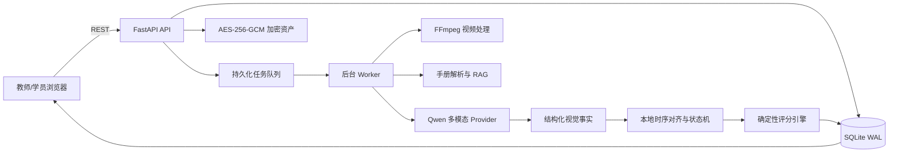
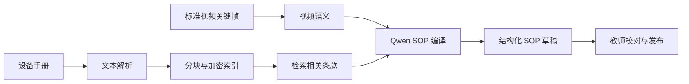

# 工序智传：项目调研分析与 PPT 制作材料

> 2026-10-15 更新：最终产品已加入实时逐步陪练、学生学习报告和教师班级学情。参赛内容以 `CONTEST_FINAL_README_2026-10-15.md` 与最终 PPT 为准，本文作为早期调研归档。

> 副标题建议：让经验可传，让操作可证  
> 文档版本：2026-08-25  
> 适用场景：iCAN 创新创业大赛项目介绍、答辩 PPT、项目说明书、团队内部统一口径  
> 项目当前阶段：主体演示闭环已实现，真实模型效果仍处于开发验证阶段，尚未达到工业级自动考评标准

---

## 0. 使用说明

这份材料不是简单的产品宣传稿，而是供 PPT 制作者直接拆页使用的“事实底稿”。文中使用三种状态：

| 状态 | 含义 |
|---|---|
| 已实现 | 当前代码和页面中已经存在，并经过本机工程测试 |
| 条件可用 | 功能链路存在，但依赖 Qwen API、视频授权、合适机位或人工准备的 SOP |
| 未验证 | 可以作为发展方向，不应在答辩时表述为已经实现或已经达到准确率 |

PPT 中所有数字都应保留其适用范围。例如，“某一个正常样本 9/9 步匹配”不能写成“系统步骤识别准确率 100%”；“后端 410 个测试通过”属于工程质量证据，不属于视觉模型准确率。

---

## 1. 执行摘要

### 1.1 一句话定义

**工序智传是一套面向职业技能实训和企业新人培训的多模态 AI 系统：它把授权的标准教学视频与操作手册转化为结构化 SOP，再对学员操作视频进行步骤级、证据化、可解释考评。**

### 1.2 项目解决的真实问题

传统技能教学和企业带教通常面临四个问题：

1. 熟练技工的经验主要保存在个人记忆和零散视频中，人员离岗后知识容易流失。
2. 把长视频和纸质手册整理成结构化 SOP，需要教师或工程师逐帧拆解，人工成本高。
3. 新人练习后的评价高度依赖教师现场观看，难以大规模、反复和一致地执行。
4. 传统考试只给总分，学员不知道“哪一步、什么时候、依据什么”被扣分。

### 1.3 核心解决方案

项目建立两个相互衔接的闭环：

- **知识编译闭环**：标准视频/手册 -> 视频抽帧与文档检索 -> Qwen 多模态理解 -> 结构化 SOP 草稿 -> 教师编辑与发布。
- **技能考评闭环**：学员视频 -> Qwen 关键帧事实识别 -> 本地步骤对齐 -> 确定性评分 -> 时间线证据、扣分原因和改进建议。

### 1.4 六项关键结论

**结论一：项目面向的是一个真实且持续存在的“技能知识传承与规模化实训”问题，主赛道应定位为智能教育中的职业技能实训，企业培训是第二落点。**

**结论二：市场并非空白。DeepHow、Poka、Augmentir、VKS 等产品已经覆盖数字作业指导、视频转工作指引或现场辅助，因此不能宣称“全球首个视频转 SOP”。**

**结论三：本项目最有竞争力的不是单个识别算法，而是“普通摄像头 + 既有教学材料 + 可执行 SOP + 证据化评分”的低成本完整闭环。**

**结论四：系统工程闭环已具备比赛演示条件，但细微方向、孔位、紧固关系等错误仍不能可靠识别。当前最大的瓶颈是目标工序数据和可观察证据设计，而不是网页是否能运行。**

**结论五：外部 Qwen 负责理解画面和生成解释，本地规则负责最终数值评分。这种职责分离既是可解释性设计，也是避免大模型随意改分的可信机制。**

**结论六：项目适合以“教育原型和比赛展示系统”参赛；在完成目标工序冻结测试、Windows 真机验收和行业规则校验之前，不适合宣称工业质检、资格认证或安全合规能力。**

---

## 2. 项目背景与社会价值

### 2.1 政策和行业背景

《教育强国建设规划纲要（2024—2035 年）》提出建设实习实训基地、实施教育数字化战略，并探索数字赋能大规模因材施教；这为“AI + 职业技能实训”提供了明确的政策方向。[教育部：《教育强国建设规划纲要（2024—2035年）》](https://www.moe.gov.cn/jyb_xxgk/moe_1777/moe_1778/202501/t20250119_1176193.html)

教育部 2026 年关于职业教育教学关键要素改革的意见进一步强调，职业教育应按照行业标准、企业标准和岗位标准推进课程、教材和实习实训改革。[教育部：关于深化职业教育教学关键要素改革的意见](https://www.moe.gov.cn/srcsite/A07/zcs_zhgg/202602/t20260212_1428773.html)

这意味着职业实训系统不能只“播放教学视频”，还应把操作标准转化为可执行、可记录、可反馈的训练过程。

### 2.2 当前教学方式的典型矛盾

| 现有方式 | 优点 | 主要不足 |
|---|---|---|
| 师傅带徒弟 | 经验真实、互动直接 | 师资占用高，标准受个人差异影响，难以规模化 |
| 纸质 SOP/PDF | 正式、便于审批 | 学习体验弱，难以表达动态动作，更新和检索不便 |
| 教学视频 | 直观、拍摄成本低 | 内容非结构化，难以快速定位步骤，也无法直接用于考评 |
| 传统线上考试 | 易组织、易统计 | 更适合知识题，无法证明实际操作是否规范 |
| 专用传感器/工业视觉 | 精度和可控性可能更高 | 改造成本高，工种适配和部署周期长 |

### 2.3 项目的社会意义

- 让教师把更多时间用于课程设计和个性化辅导，而不是重复观看整段视频。
- 让技能学习者获得可重复练习和步骤级反馈，降低“只知道错、不知道错在哪”的挫败感。
- 让中小企业用既有手机、摄像头和培训材料构建基础数字化培训能力。
- 让优秀技工的隐性经验逐步转化为可检索、可更新、可追溯的组织知识。
- 为校企共同开发实训标准提供统一的数据载体和演示工具。

**分析结论：项目的社会价值应聚焦“技能教育公平、经验传承和训练反馈”，不应把主叙事放在替代教师或自动颁发工业资格。**

---

## 3. 核心目标、定位与边界

### 3.1 产品定位

| 维度 | 定位 |
|---|---|
| 主应用领域 | 职业院校实训、技能课程练习和考评辅助 |
| 次应用领域 | 企业新人上岗培训、维修知识沉淀、标准作业复习 |
| 核心用户价值 | 降低 SOP 制作成本，提高训练反馈速度，让评分有证据 |
| 首版硬件 | 普通电脑、浏览器、单摄像头或预录视频 |
| 首版工序 | 单人、单工位、5 至 8 个主要步骤、安全可重复、关键状态可从画面观察 |
| AI 路线 | 外部 Qwen 多模态 API 为主，本地规则完成对齐和评分 |
| 产品形态 | 本地 Web/PWA + 后端服务 + 外部多模态 Provider |

当前比赛演示使用“模块小车装配实训”作为样例，共 9 个部件安装步骤。它可以展示完整产品流程，但来自 IndustReal 第一视角数据，与最终建议的固定工位普通摄像头场景存在域差异。

### 3.2 核心目标

1. 将标准教学视频和手册转成结构化、可编辑、可版本化的 SOP。
2. 将学员视频中的可见操作事实对齐到 SOP 步骤。
3. 用固定规则输出可复核分数，而不是让大模型直接“凭感觉打分”。
4. 为每个判断绑定时间区间、关键帧和理由。
5. 在证据不足时明确输出“无法判断”，避免伪精确。
6. 通过角色权限、加密、最小化外发和审计记录保护教学与企业视频。

### 3.3 明确不做的事情

- 不替代教师、考评员或企业安全责任人作最终资格认定。
- 不声称从任意视频中自动识别所有工种和所有工具。
- 不从普通视频判断真实扭矩、电压、压力、内部连接质量等不可见参数。
- 不把工程回放数据冒充真人模型准确率。
- 不在当前项目中训练和发布自研本地“大而全”动作模型。
- 不把公开数据的研究许可自动解释为允许发送到第三方 API。
- 不提供实时摄像头训练辅助和工位标定配置；正式输入统一为预录操作视频。

**分析结论：清晰的拒判和能力边界不是“功能少”，而是项目可信度的重要组成部分。**

---

## 4. 目标用户群体与需求分析

### 4.1 核心用户

| 用户 | 核心需求 | 系统提供的价值 |
|---|---|---|
| 职业院校教师/实训指导教师 | 快速制作实训 SOP，减少重复看视频，统一评分口径 | 视频生成 SOP、版本发布、批量查看报告、证据回放 |
| 职业院校学生/技能学习者 | 随时练习，快速知道错在哪一步 | 视频提交、步骤时间线、分项得分和改进建议 |
| 企业培训师/班组长 | 保存熟练员工经验，加快新人熟悉工序 | 知识导入、标准步骤固化、训练记录 |
| 新入职技工 | 在没有师傅全程陪同的情况下复习和自测 | SOP 指引、预录视频考评和步骤复盘 |
| 教务或培训管理员 | 管理账号、课程版本和访问权限 | 角色账号、审计记录、数据与模型状态 |
| 观察者/评委 | 查看流程、证据和结果，但不修改业务数据 | 只读访问和答辩展示 |

### 4.2 首批落地场景选择原则

最适合首版的工序应满足：

- 5 至 8 个主要步骤，单次 1 至 5 分钟；
- 操作者、工具和关键零件在画面中可见；
- 正确和错误操作在视觉上存在明显差异；
- 不涉及高压、高温、高空、旋转机械等危险演示；
- 有真实标准视频和合法使用的操作手册；
- 可由团队录制完整、漏步、错序、错工具、遮挡等对照视频。

推荐优先选择：小型滤芯更换、机械模块装配、桌面教学套件拆装、低风险仪器维护。网线水晶头制作可以演示顺序，但压接质量仍需要近景或专用检测仪；低压教学板接线具有教育价值，但必须避免把画面判断当作电气安全认证。

### 4.3 当前样例的适用与不足

“模块小车装配”具备步骤清晰、零件较多、演示直观的优点，但当前项目中没有与该视频真正配套的操作手册。现有 SOP 的来源等级是 `video_reference`，因此可以演示“视频生成 SOP”和“视频考评”，不应演示为“手册 RAG 已验证了该小车的工艺标准”。

**分析结论：参赛前最好增加一个团队自有的目标工序，配套真实手册、标准视频和错误视频；这比继续增加泛化页面更能提升说服力。**

---

## 5. 产品用户流程

### 5.1 教师端：从材料到 SOP

1. 教师登录系统，进入“知识导入”。
2. 上传已授权的标准教学视频，可同时上传 PDF、DOCX 或 TXT 手册。
3. 系统计算文件 SHA256，并将资产以 AES-256-GCM 加密保存。
4. 手册被解析、切分和建立检索索引；视频进入后台任务队列。
5. 教师明确授权后，系统只向 Qwen 发送完成任务所需的压缩关键帧和相关手册片段。
6. Qwen 输出受控 JSON，系统生成 SOP 草稿，包括步骤、工具、对象、动作、前置关系、关键性和可观察检查。
7. 教师在“SOP 编译室”校对、调整权重和规则。
8. 校验通过后发布版本；已发布版本不可原地篡改，后续修改形成新版本。

### 5.2 学员端：从视频到证据报告

1. 学员进入“考评中心”，选择已发布 SOP。
2. 上传本人操作视频，并确认关键帧外发授权。
3. 后台通过 FFmpeg 获取时长、抽取动作锚点和关键帧。
4. Qwen 按受控词表识别工具、对象、动作、操作阶段、候选步骤和画面依据。
5. 本地系统合并时序事实、校验 SOP 语义并完成步骤对齐。
6. 确定性评分引擎计算总分、维度分、覆盖率和结论。
7. 学员在统一证据播放器中查看步骤时间线、关键帧、扣分理由和改进建议。

### 5.3 管理员和观察者

- 管理员创建、停用教师、学员、观察者和管理员账号。
- 教师可管理知识、SOP 和考评。
- 学员只能查看自己的会话、视频证据和报告。
- 观察者用于只读查看，不参与内容修改。

---

## 6. 主要功能模块与完成状态

| 模块 | 主要能力 | 当前状态 | PPT 展示价值 |
|---|---|---|---|
| 账号与角色 | admin、instructor、learner、observer；HttpOnly 会话和权限隔离 | 已实现 | 展示产品不是单页 Demo，而是多角色系统 |
| 知识导入 | 标准视频、PDF/DOCX/TXT 手册上传、哈希、加密和后台处理 | 已实现 | 展示传统材料进入数字流程 |
| 手册 RAG | 文档解析、加密分块、混合检索、来源片段回溯 | 已实现；取决于真实手册 | 展示 SOP 有来源，不只是模型自由生成 |
| SOP 编译室 | Qwen 视频理解、受控词表、草稿编辑、校验、版本和发布 | 条件可用 | 项目第一核心功能 |
| 预录考评中心 | 上传视频、任务进度、证据提取、步骤对齐和报告 | 条件可用 | 项目第二核心功能 |
| 证据播放器 | 视频/关键帧、步骤时间线、分数、理由和建议 | 已实现 | 最适合在答辩中体现“可解释” |
| 数据与模型 | Provider 状态、视觉探测、数据集就绪情况和模型信息 | 已实现 | 展示可运维性和诚实边界 |
| 后台任务 | SQLite 持久化任务、worker、重试、检查点和进度查询 | 已实现 | 支撑长视频和 API 长延迟 |
| 工程演示回放 | 完整、明确错误、证据不足三类预置报告 | 已实现 | API 故障时的答辩保底，必须标注为工程回放 |
| 离线人工复核 | 原页面和普通导航入口已删除 | 不再作为产品功能 | PPT 不应继续出现该模块 |
| Windows 11 | PowerShell 安装、启动、停止脚本 | 代码已实现，待真机全流程验收 | 可说明支持计划，不能说已完成全机型验收 |
| 便携包/Docker 成品 | 无网冷启动、完整发布物和供应链材料 | 暂缓 | 不作为本次主体演示前提 |

---

## 7. 技术架构选型

### 7.1 总体架构

### 7.2 技术栈

| 层级 | 选型 | 选择理由 |
|---|---|---|
| 前端 | Vue 3、TypeScript、Vite | 组件化、开发效率高、适合中小型比赛项目 |
| 状态与可视化 | Pinia、ECharts、Canvas 2D | 管理业务状态，呈现时间线、分数和证据 |
| PWA | Vite PWA | 提升安装和缓存体验，适合实训场地浏览器使用 |
| 后端 | Python 3.12、FastAPI、Pydantic | 多媒体与 AI 生态成熟，接口开发和 Schema 校验直接 |
| 数据访问 | SQLAlchemy 2、Alembic | 保持实体定义和数据库版本可演进 |
| 数据库 | SQLite WAL | 单机比赛演示部署简单，也支持后台任务并发读写 |
| 视频处理 | FFmpeg | 成熟的探测、转码、抽帧和时间定位能力 |
| 多模态 AI | Qwen API，经 Provider 适配层调用 | 不要求比赛电脑训练或部署大模型，支持视觉和结构化输出 |
| 安全 | Argon2、HttpOnly 会话、CSRF、AES-256-GCM | 覆盖账号、会话、写操作和本地视频资产 |
| 测试 | Pytest、Vitest、Playwright | 覆盖后端逻辑、前端服务和真实浏览器流程 |

阿里云官方文档显示，其 Model Studio 提供 OpenAI 兼容的 Qwen 视觉接口，并支持图像/视频理解和结构化输出，这与项目的 Provider 适配设计相匹配。[Alibaba Cloud Model Studio：视觉理解](https://www.alibabacloud.com/help/en/model-studio/vision-model/) [OpenAI 兼容视觉接口](https://www.alibabacloud.com/help/en/model-studio/qwen-vl-compatible-with-openai)

### 7.3 为什么不让大模型直接打分

大模型适合回答“画面里发生了什么”和“如何用自然语言解释”，但直接输出总分会带来三个问题：同一视频多次结果可能波动、规则难以审计、教师无法准确说明扣分来源。

因此系统采用职责分离：

| 环节 | Qwen 负责 | 本地程序负责 |
|---|---|---|
| SOP 生成 | 理解视频和手册语义，输出结构化草稿 | Schema 校验、受控词表、版本和发布 |
| 视频考评 | 识别关键帧中的工具、对象、动作和可见状态 | 时序合并、步骤对齐、覆盖率和拒判 |
| 分数 | 不修改数值 | 按冻结权重和规则计算 |
| 反馈 | 将已经成立的事实转成易懂建议 | 约束输入证据，保存理由和规则代码 |

**分析结论：项目中的“大模型”是语义感知与表达层，不是不可审计的裁判。**

### 7.4 RAG 在项目中的作用

RAG 用于将手册中的步骤要求、安全条件和部件说明提供给 SOP 编译过程。它的价值不是“让回答更像聊天机器人”，而是让生成内容能够回到来源片段。

来源等级建议在 PPT 中说明：

- `manual_grounded`：视频步骤得到配套手册片段支持，可信度最高。
- `video_reference`：步骤只来源于标准视频，需要教师校对。
- `fixture_replay`：仅用于工程交互演示，不能作为真实模型结论。

当前模块小车 SOP 属于 `video_reference`，不是手册支撑型 SOP。

---

## 8. 步骤对齐、评分和可信拒判

### 8.1 视觉事实而非像素复刻

系统不要求学员视频与标准视频像素完全一致，而是尽量比较“手、工具、对象、动作、状态变化、时间关系”等结构化事实。这比直接计算两段视频画面相似度更能适应操作者身高、动作速度和轻微机位变化。

跨视角适配仍是研发问题。固定机位、人体/手部尺度归一化、对象关系和多视角数据可以降低差异，但当前尚无足够数据证明“跨视角问题已经解决”。严重遮挡、关键部位离开画面时必须拒判，或在录制规范中要求补充近景/第二机位。

### 8.2 当前评分规则 `scoring-v6`

| 评分维度 | 权重 |
|---|---:|
| 步骤完整性 | 30% |
| 操作顺序 | 20% |
| 工具与零件 | 15% |
| 动作规范 | 20% |
| 操作效率 | 5% |
| 可观察安全规范 | 10% |

主要判定规则：

- 总分达到 60 分且证据门槛满足时判定通过。
- 明确发现关键步骤错误时，总分最高 59 分并判定未通过。
- “没有识别到”不等同于“明确做错”，不会仅因漏检就锁定 59 分。
- 必做步骤证据覆盖率低于 80%、关键步骤不可判断或关键安全检查缺证据时，结果为“无法判断”。
- 不可观察步骤权重超过 20% 时，结果为“无法判断”。
- 完成状态缺少静态证据会显示复核提示，但不再单独否决一个高覆盖、高分且动作证据充分的操作。

### 8.3 为什么很多旧报告是 59 分

历史评分版本把关键步骤缺失或某些证据不足一律封顶为 59，导致不同失败程度集中到同一分数。`scoring-v6` 已调整为：只有明确关键错误才封顶 59，漏检通过覆盖率和“无法判断”体现。旧报告仍保留用于溯源，不应与新版本混合比较。

### 8.4 可信拒判的演示价值

评委通常会追问：“画面遮挡了怎么办？”正确回答不是“模型也能猜出来”，而是：

> 系统区分错误和证据不足。明确看到错误才扣分；关键部位看不清时返回无法判断，并指出缺少哪类证据，避免让生成式模型代替事实。

这能把“模型有局限”转化为一项可信产品设计。

---

## 9. 数据、模型与真实验证现状

### 9.1 数据集现状

主开发数据为 IndustReal v2。其官方项目介绍显示，数据包含 27 名参与者完成玩具装配和维护工序的第一视角视频，并提供工序步骤识别及执行错误相关标注。[IndustReal 官方项目](https://github.com/TimSchoonbeek/industreal) [IndustReal 论文](https://arxiv.org/abs/2310.17323)

当前本地已准备：

| 项目 | 数量/状态 |
|---|---|
| IndustReal v2 `train + val` | 52 段视频，36 train + 16 val |
| 总时长 | 11,696.8 秒，约 3.25 小时 |
| 动作片段 | 5,595 个 |
| 含错误版本完成事件 | 463 个，其中 19 个错误事件 |
| 官方 held-out test | 未访问、未用于调参 |
| 数据用途 | Qwen 开发验证和工程流水线，不进行本地模型训练 |

其他数据状态：

- IMPACT v1.1：有官方清单和 quick-start 媒体，适合多视角工程联调；不作为正式指标集。
- Assembly101：本地主要是标注，完整媒体受访问条款约束。
- CaptainCook4D：本地只有标注，且属于烹饪域，不作为工业装配指标。

### 9.2 模型路线

- 当前主要模型是外部 Qwen 多模态 API。
- 本项目不训练自研本地动作模型，也不能把 Qwen 说成团队训练的模型。
- 本地已有手部和 YOLO 兼容组件只作为历史/辅助能力，不是当前产品评分的主体模型。
- 项目通过 Prompt、受控词表、关键帧采样、结构化输出校验和本地规则提升稳定性。

### 9.3 已完成的真实 Provider 开发样本

以下结果只用于说明当前能力边界，不是正式准确率：

| 样本 | 结果 | 应如何解释 |
|---|---|---|
| 正常装配 `01_assy_0_1` | v19 中 9/9 步状态匹配，步骤宏 F1 为 1.0；21 次 Qwen 调用，约 435 秒 | 证明某个正常样本能够完成步骤级对齐；不能外推为总体准确率 100% |
| 真实错误 `15_main_3_1` | 官方第 7 步错误被漏检，同时正常第 5 步被误判；该样本错误召回为 0 | 证明细微错误识别仍是当前主要短板，顶层“未通过”碰巧命中也不能作为成功宣传 |

在当前 `scoring-v6` 下，已有正常样本的相同证据可得到 95 分并通过；这是评分规则对同一份证据的重算结果，不是重新完成了一次独立模型测试。

历史上对 16 段 `val` 的一次全量运行后来发现 SOP 步骤顺序错误，因此旧的准确率、F1 和拒判率均已失效，不能放进 PPT。

### 9.4 当前工程验证

截至 2026-08-25 的最近本机回归结果：

- 后端测试：410 项通过。
- 前端 Vitest：5 个测试文件、24 项测试通过。
- Playwright：11 项通过，1 项真实拒判 smoke 因当前启用 Qwen 后端而按安全约束跳过。
- 前端生产构建和 PWA 30 项资源预缓存生成通过。
- 目标 Ruff 与 Mypy 检查通过。
- 本机 macOS 的 API、worker 和前端可共同启动。

这些结果能证明账号、加密、任务、SOP、考评、评分、页面等工程逻辑稳定，但不能证明真实视觉识别准确率。

### 9.5 分析结论

**当前项目已经能够完整演示“材料进入系统、生成 SOP、提交视频、输出证据报告”的产品流程；但数据只支持开发原型结论，尚不足以支撑“可靠发现工业操作错误”或“跨工种泛化”的宣传。**

---

## 10. 隐私、安全与数据治理

### 10.1 本地保存与外部发送的边界

| 数据 | 本地处理 | 是否发送给 Qwen |
|---|---|---|
| 完整教学/学员视频 | 计算 SHA256、AES-256-GCM 加密保存 | 不发送完整视频 |
| 临时明文 | 仅在受控临时目录解密处理，任务后清理 | 不直接发送 |
| 压缩关键帧 | 从授权视频中按任务需要抽取 | 明确授权后才发送 |
| 手册相关片段 | 加密索引并按 SOP 需求检索 | 只发送与当前步骤有关的最小片段 |
| 账号、密码、总分 | 本地数据库和会话管理 | 不发送 |
| 结构化视觉事实 | 本地保存用于对齐和报告 | 由 Provider 返回 |

### 10.2 已实现的安全机制

- Argon2 密码哈希。
- HttpOnly 会话 Cookie，数据库只保存令牌摘要。
- CSRF 双提交令牌保护写操作。
- 角色访问控制和学员数据隔离。
- AES-256-GCM 文件与文本加密；错误密钥或篡改密文会解密失败。
- 上传、登录、资产访问、Provider 探测等行为写入审计记录。
- API Key 只存在后端环境变量，不进入浏览器和 Git。
- Provider 不可用或未授权时明确失败，不用 Replay 冒充真实分析。

### 10.3 尚需完善的治理问题

- 明确记录云服务区域、留存策略、是否用于模型训练和子处理方。
- 对企业手册建立保密等级和外发字段白名单。
- 参赛使用真人视频时准备书面授权和删除说明。
- 发布前完成 Windows 目录、日志和临时明文清理的真机检查。

**分析结论：项目的隐私创新不是“完全不看画面”，而是“完整视频加密本地保存、只在授权后最小化外发关键帧、账号与评分数据不出站”。**

---

## 11. 市场与竞品调研

### 11.1 市场类别

工序智传处在三个市场的交叉位置：

1. 职业教育数字化与虚拟/智能实训；
2. 数字作业指导书（Digital Work Instructions）；
3. Connected Worker/一线员工知识与绩效辅助平台。

这一市场已经验证了“将视频、文档和一线经验数字化”的需求，但企业级竞品往往面向大型制造组织、多工厂协作和系统集成。工序智传的机会不在于和成熟平台比功能数量，而在于以更低部署门槛服务职业实训和中小规模试点。

### 11.2 代表性竞品

#### DeepHow

DeepHow 是最接近的直接竞品。其官方页面已经公开“Live SOP Verification”，强调通过视觉语言模型理解现场工作，并实时核验是否按 SOP 执行，同时提供即时反馈。[DeepHow：Live SOP Verification](https://deephow.com/platform/sop-adherence)

对本项目的启示：不能把“实时 SOP 核验”作为唯一创新点；必须突出教育定位、低成本部署、证据化评分和可信拒判。

#### Poka

Poka 提供面向制造业的一线员工平台，支持把 PDF、Word、视频和纸质内容转为数字作业指导，并强调版本、培训、协作、分析和企业系统集成。[Poka：Digital Work Instructions](https://www.poka.io/en/digital-work-instructions/) [Poka：Connected Worker Platform](https://www.poka.io/en/connected-worker-platform/)

对本项目的启示：视频转步骤本身已经商品化。工序智传应把“从教学材料编译出考评规则，并对学习者操作生成证据报告”作为区别。

#### Augmentir

Augmentir 将数字工作指引、技能管理、远程协作和 AI 个性化支持整合为 Connected Worker 平台，重点是根据员工技能和现场数据提供个性化指导。[Augmentir：Digital Work Instructions](https://www.augmentir.com/fr/lp/digital-work-instructions)

对本项目的启示：个性化培训和技能画像具有后续价值，但首版不应为了追赶企业套件而扩张范围。

#### VKS

VKS 以可视化数字作业指导和智能表单为核心，支持图片、视频、注释、检查表和现场数据采集。[VKS：Digital Work Instructions](https://vksapp.com/what-are-digital-work-instructions)

对本项目的启示：数字 SOP 编辑和展示属于基础能力；AI 自动理解和证据评分才是本项目需要被评委记住的部分。

### 11.3 竞品对比矩阵

以下比较依据各产品公开页面，未采购企业版本，不代表完整功能审计。

| 对比维度 | 工序智传 | DeepHow | Poka | Augmentir | VKS |
|---|---|---|---|---|---|
| 主要定位 | 职业实训 + 低成本技能考评 | 工业知识与实时 SOP 核验 | 企业 Connected Worker | AI 原生 Connected Worker | 数字作业指导 |
| 视频/文档转指导 | 有 | 有 | 有 | 有数字工作流创作 | 以可视化创作为主 |
| 操作视频自动评分 | 有原型，步骤证据化 | 强调实时 SOP 验证 | 公开页面重点不在自动视频打分 | 公开页面重点为个性化指导 | 公开页面重点为指导与数据采集 |
| 数值评分机制 | 本地确定性规则，大模型不改分 | 未在公开页披露具体评分实现 | 未公开 | 未公开 | 主要不是自动视觉评分 |
| 可信拒判 | 明确设计 | 公开页强调核验，拒判细节未披露 | 未公开 | 未公开 | 非核心 |
| 部署硬件 | 普通浏览器和摄像头 | 面向企业现场 | 企业移动端/网页 | 手机、平板、桌面和可穿戴设备 | 平板/网页等 |
| 目标客户 | 职校、培训机构、中小企业试点 | 制造企业 | 中大型制造企业 | 工业企业 | 制造企业 |
| 企业级集成 | 尚未建设 | 有企业平台能力 | 强 ERP/MES/LMS 等集成 | 有企业集成能力 | 有作业数据能力 |
| 当前成熟度 | 比赛级开发原型 | 商业产品 | 商业产品 | 商业产品 | 商业产品 |

### 11.4 竞争战略结论

**不能宣称：**

- 全球首个视频转 SOP；
- 首个实时 SOP 验证系统；
- 无需数据即可识别所有工种；
- 普通视频可判断真实扭矩、电压或内部装配质量；
- 大模型能够替代行业安全认证。

**可以建立的差异化：**

1. 以职业技能学习闭环而不是大型工厂管理套件为切入点。
2. 使用普通摄像头和现有教学材料，降低试点门槛。
3. 将标准视频直接“编译”为结构化 SOP 与考评规则。
4. 大模型只负责事实和解释，评分由冻结规则完成。
5. 每个扣分项绑定时间证据和可追溯依据。
6. 对遮挡、不可见参数和证据不足进行可信拒判。
7. 只发送必要关键帧，完整视频和账号数据保留在本地。

**关键结论：竞品证明了需求存在，也迫使项目从“有 AI”升级为“有明确教育场景、有可信机制、有低成本闭环”。**

---

## 12. 创新点提炼

### 创新点一：把教学材料编译为可执行考评

传统“视频转 SOP”只生成图文说明；工序智传进一步把步骤、前置关系、工具、对象、动作、关键性、权重和可观察检查写入结构化 Schema，使同一份 SOP 能直接驱动后续考评。

答辩表达：

> 我们不是把视频变成另一份静态文档，而是把视频编译成机器和教师都能使用的考评规则。

### 创新点二：语义识别和数值评分解耦

Qwen 输出可见事实，本地状态机和固定公式输出分数。模型升级不会悄悄改变评分制度，每份报告保存模型版本、SOP 版本和评分规则版本。

答辩表达：

> 大模型负责看懂，规则引擎负责裁决，教师能够解释每一分从哪里来。

### 创新点三：证据化而非黑盒总分

步骤结果绑定时间区间、关键帧、置信度、规则代码和改进建议。教师可以回到原视频核对，学生可以准确复习。

答辩表达：

> 分数不是终点，能够复盘的证据才是训练真正产生价值的地方。

### 创新点四：面向跨视角的关系表达

系统尝试比较工具、对象、动作和状态关系，而不是直接比较像素或要求学员逐帧模仿标准视频。该设计方向有创新价值，但当前跨视角泛化尚未正式验证，PPT 应表述为“技术设计”而不是“已解决”。

### 创新点五：可信拒判

系统将“明确错误”和“没有看清”分开。关键证据不足时不给出伪精确合格结论，并提示补拍角度或缺失证据。

### 创新点六：隐私最小化的外部多模态调用

系统不上传完整视频，只在授权后外发完成任务所需的压缩关键帧，账号、总分和完整资产不进入 Provider 请求。

---

## 13. 潜在风险、挑战与应对策略

| 风险 | 当前表现 | 影响 | 应对策略 | 优先级 |
|---|---|---|---|---|
| 细粒度错误难识别 | 孔位、方向、紧固关系可能在单帧不可见 | 误判或漏判 | 为关键错误增加近景证据、动作前后对照、结构化检查；必要时加第二机位 | 最高 |
| 目标域数据不足 | 公开数据是第一视角玩具装配 | 无法证明固定摄像头实训效果 | 录制团队自有目标工序数据，按人和视角隔离，冻结测试集 | 最高 |
| 当前样例无真实手册 | 小车 SOP 仅由视频生成 | RAG 价值无法在该样例中成立 | 增加配套说明书的自有工序，或明确不演示手册支撑 | 高 |
| Qwen 延迟较长 | 新视频约 5 至 8 分钟，20 次左右调用 | 现场等待影响演示 | 现场用已完成真实报告；上传新视频展示进度；保留缓存与断点 | 高 |
| 外部 API 不稳定 | 网络、限流、模型变更或余额不足 | SOP/考评中断 | Provider 探测、重试、批次降级、缓存和工程回放保底 | 高 |
| API 成本不确定 | 每段视频可能消耗数万 token | 大规模使用成本上升 | 关键帧预算、分层模型、重复结果缓存、按工序估算单次成本 | 中高 |
| 跨视角差异 | 第一视角和固定工位差异明显 | 识别泛化下降 | 固定工位标定、关系事实、视角增强和明确拒判 | 高 |
| 隐私与授权 | 真人和企业视频可能敏感 | 合规和信任风险 | 最小化外发、书面授权、区域/留存说明、敏感工序禁止外发 | 高 |
| 评分规则被质疑 | 60 分阈值和权重属于产品规则 | 评委认为主观 | 展示可配置和版本化；由课程目标确定权重；模型不能自行改分 | 中 |
| 工业级表述过度 | 工程演示容易被误写成工业验证 | 可信度受损 | 使用 Claims Sheet，明确“开发原型/单样本/未验证” | 最高 |
| Windows 真机差异 | 脚本存在但未全流程真机验收 | 队友电脑运行失败 | 在真实 Windows 11 完成 FFmpeg、视频上传、中文路径和长任务测试 | 高 |
| 单机 SQLite 扩展性 | 适合比赛和小规模试点 | 不适合多工厂并发 | 商业化阶段再迁移 PostgreSQL、对象存储和分布式队列 | 低于当前 |

### 风险分析结论

**项目当前的主要风险不是“AI 能不能看见人”，而是能否为每个重要错误设计足够清晰、合法且可重复的视觉证据。** 对不可见质量要求，正确的产品策略是接入量具/传感器或拒判，而不是继续扩大 Prompt。

---

## 14. 可行性评估

### 14.1 分维度评估

| 维度 | 评分（5 分制） | 判断 |
|---|---:|---|
| 需求真实性 | 4.5 | 职业实训、知识传承和数字作业指导均有明确需求 |
| 工程实现 | 4.5 | 主体前后端、任务、加密、SOP、报告和回放已经形成闭环 |
| 比赛演示 | 4.3 | 可完整演示，但必须规避现场等待和模型过度声明 |
| 多模态识别效果 | 2.6 | 正常步骤已有可用样本，细微错误和跨视角仍弱 |
| 数据与评测 | 2.8 | 公开开发数据已准备，但缺少目标域冻结测试集 |
| 隐私与安全 | 4.0 | 技术机制较完整，外部 Provider 治理和书面授权仍需补充 |
| Windows 部署 | 3.2 | 脚本和依赖契约存在，真机全流程与便携包未完成 |
| 商业化 | 3.0 | 适合小规模试点，距离企业系统集成和稳定 SLA 尚远 |

综合判断：**可参赛展示，可做学校或中小企业试点，不适合直接作为工业合格判定系统交付。**

### 14.2 技术可行性

高。核心技术组件已有成熟开源基础，外部多模态 API 降低了本地训练和硬件门槛。当前系统代码已经完成主要集成。剩余难点集中在领域数据、相机布置、错误可观察性和 Provider 稳定性。

### 14.3 经济可行性

中等。普通摄像头和浏览器降低了硬件投入，但外部多模态调用会形成持续成本。正式试点应按“每段视频平均调用次数、token、时长和缓存命中率”测算单次考评成本，而不是使用未经验证的市场价格假设。

### 14.4 运营可行性

中等。教师仍需校对和发布 SOP，这不是系统缺陷，而是保证课程标准正确的必要责任。后续应优化批量导入、模板复用和课程管理，避免每个工序从零开始。

### 14.5 合规可行性

中等。教学场景可通过知情授权、最小化外发、账号隔离和删除策略控制风险；涉及企业机密工艺、未成年人或职业资格认定时，需要额外制度和合同，不应只依赖技术措施。

---

## 15. 应用前景与发展路线

### 15.1 近期：职业实训工具

- 面向一门课程、一个工位、一个标准工序试点。
- 教师制作 SOP，学生课后反复提交视频。
- 系统提供形成性评价，教师保留最终认定权。
- 收集真实使用反馈和错误样本，形成可复现案例。

### 15.2 中期：校企协同实训平台

- 企业提供标准视频和脱敏手册，学校形成课程 SOP。
- 同一工序支持多个难度等级和角色版本。
- 增加班级、课程、作业、训练趋势和技能画像。
- 与学校 LMS、实训室预约或企业培训系统对接。

### 15.3 长期：一线知识传承与智能辅助

- 覆盖设备巡检、维护、装配、质检和服务流程。
- 接入扭矩扳手、扫码枪、量具等非视觉证据。
- 支持批量课程、多个标准工序和边缘推理。
- 形成组织级 SOP 知识图谱、版本治理和能力矩阵。

### 15.4 可探索的商业模式

- 学校实训室按课程/工位授权。
- 企业按站点或活跃培训人数订阅。
- 针对具体工序提供数据准备、SOP 数字化和试点服务。
- 为设备厂商提供配套数字培训内容工具。

以上是商业假设，不是已有合同或收入。PPT 应优先讲清楚首个试点如何发生，而不是给出未经调研的巨大市场规模。

---

## 16. 比赛展示策略

### 16.1 评委应在六分钟内记住什么

1. 一个老技工的教学视频可以快速变成结构化 SOP。
2. 新人完成操作后，系统不是只给一个分，而是指出哪一步、什么时候、为什么。
3. Qwen 负责看懂，本地规则负责评分，结果可追溯。
4. 看不清就拒判，完整视频不直接发送到云端。
5. 这套方法首先服务职业实训，未来可扩展到企业知识传承。

### 16.2 六分钟答辩演示脚本

| 时间 | 演示内容 | 讲述重点 |
|---|---|---|
| 0:00-0:35 | 一句话痛点和场景 | “经验在视频里，但视频不能直接教学、考评和传承。” |
| 0:35-1:05 | 展示双闭环架构图 | 标准材料生成 SOP，学员视频生成证据报告 |
| 1:05-1:55 | 教师端知识导入和已有标准视频 | 强调授权、加密、手册来源；模块小车无手册时不要假装有 |
| 1:55-2:40 | SOP 编译室 | 展示步骤、工具、对象、前置关系、关键步骤和版本发布 |
| 2:40-3:15 | 学员选择 SOP 并上传视频 | 展示授权开关、后台进度和任务可恢复；不等待现场完整跑完 |
| 3:15-4:30 | 打开提前完成的真实 95 分报告 | 播放证据时间线、维度分、步骤结果、模型和规则版本 |
| 4:30-5:15 | 打开错误或证据不足工程回放 | 展示“明确错误”和“无法判断”的差异，明确 Replay 只是工程演示 |
| 5:15-5:45 | 隐私和可信机制 | 完整视频加密本地保存，授权后只发关键帧，大模型不改分 |
| 5:45-6:00 | 总结 | “把经验编译成标准，把练习转化为证据。” |

### 16.3 为什么现场不等待真实分析完成

当前模块小车新视频的 Qwen 分析通常需要约 5 至 8 分钟，并进行约 20 次调用。六分钟答辩中应采用“现场提交并展示进度 + 打开事先完成的同一流程真实报告”。完全相同的用户、视频哈希、SOP、模型和评分规则可以命中可信缓存，在数秒内打开结果。

这不是伪造实时结果，而是合理的软件演示编排。必须同时说明：正式考评属于后台长任务，现场提交用于展示真实任务进度，结论来自事先完成并可核对哈希的报告。

### 16.4 API 故障备用方案

1. 展示已归档的真实 Qwen 报告和 Provider 调用统计。
2. 使用三类预置工程回放展示 UI 和规则逻辑。
3. 页面必须保留 `fixture_replay` 标识，讲解时主动说明它只验证交互和评分流程。
4. 不把工程回放称作“模型现场识别”。

---

## 17. 建议的 PPT 结构

### 第 1 页：封面

- 标题：工序智传
- 副标题：让经验可传，让操作可证
- 类别：多模态 AI 职业技能实训与证据化考评系统
- 画面：标准视频、结构化 SOP、学员操作、证据时间线四段式视觉

### 第 2 页：真实问题

- 老师/师傅重复示范，优秀经验难保存。
- 长视频不能直接变成训练标准。
- 学员操作评价慢、主观、缺少证据。
- 核心结论：缺的不是更多视频，而是把视频转化为可执行训练规则的工具。

### 第 3 页：目标用户与场景

- 职业院校教师和学生为主。
- 企业培训师和新人为辅。
- 单人、单工位、可观察的安全工序。

### 第 4 页：产品双闭环

- 上半部分：标准视频/手册 -> SOP。
- 下半部分：学员视频 -> 证据报告。
- 中间用“同一个结构化 SOP”连接。

### 第 5 页：教师端功能

- 知识导入、手册 RAG、SOP 草稿、编辑、校验、版本发布。
- 截图建议：知识导入页 + SOP 编译室步骤编辑。

### 第 6 页：学员端功能

- 选择 SOP、上传视频、任务进度、证据播放器、改进建议。
- 截图建议：考评向导 + 95 分真实报告。

### 第 7 页：核心技术架构

- Vue/PWA、FastAPI、SQLite、Worker、FFmpeg、Qwen、状态机和评分引擎。
- 强调外部模型与本地裁决分离。

### 第 8 页：三项核心创新

- 视频编译为可执行 SOP。
- 大模型理解、本地规则评分。
- 每个扣分项绑定证据，并能可信拒判。

### 第 9 页：隐私保护

- 完整视频本地加密。
- 明确授权才发送必要关键帧。
- 账号、总分、完整视频不出站。
- 角色隔离与审计。

### 第 10 页：真实验证

- 工程测试通过情况。
- IndustReal 52 段开发数据就绪。
- 一个正常样本 9/9 步匹配。
- 同时主动展示错误样本的短板：细微错误召回仍不足。
- 标题建议：“我们验证了什么，也明确没有验证什么”。

### 第 11 页：竞品与差异化

- DeepHow、Poka、Augmentir、VKS。
- 不做功能数量对拼；突出职业教育、普通摄像头、考评规则、证据和拒判。

### 第 12 页：可行性和风险

- 工程与演示可行性高。
- 模型泛化和目标域数据是主要风险。
- 用自有工序、配套手册、固定机位和冻结测试解决。

### 第 13 页：应用前景

- 近期：单课程实训工具。
- 中期：校企共建训练平台。
- 长期：企业知识传承与多源证据系统。

### 第 14 页：现场演示

- 用一张流程图提示评委接下来看到的 4 个动作：生成、发布、提交、复盘。
- 该页可以在进入网页前停留 10 秒。

### 第 15 页：结束页

- 结论句：把经验编译成标准，把练习转化为证据。
- 不堆叠功能列表，保留产品名称和核心闭环。

---

## 18. PPT 可直接使用的文案

### 18.1 30 秒项目介绍

> 工序智传面向职业技能实训和企业新人培训。教师可以把标准教学视频和操作手册导入系统，由多模态 AI 生成结构化 SOP；学员上传自己的操作视频后，系统将可见动作对齐到 SOP，并用固定规则生成步骤级分数、证据时间线和改进建议。完整视频加密保存在本地，只有在明确授权后才发送必要关键帧。我们的目标不是替代教师，而是把教师从重复看视频中解放出来，让每一次练习都有可复盘的证据。

### 18.2 15 秒创新点

> 项目的创新不是简单识别动作，而是把标准视频编译成可执行的考评规则。大模型负责看懂画面，本地规则负责评分，每个扣分项都有时间证据；看不清时系统会明确拒判，不用大模型猜测。

### 18.3 15 秒社会价值

> 它让优秀技工的经验不再只留在个人和长视频里，也让职业院校学生在没有老师全程陪同的情况下获得一致、及时、可解释的训练反馈。

### 18.4 回答“你们和普通视频教学有什么不同”

> 普通视频只能观看，工序智传把视频拆成带前置关系、工具、对象和可观察规则的结构化 SOP；这份 SOP 还能直接驱动学员视频的步骤对齐和证据化考评。

### 18.5 回答“为什么要用大模型”

> 工业和实训动作包含大量长尾工具、对象和自然语言说明，单一封闭分类器很难快速迁移。多模态大模型负责开放语义理解，受控词表和本地状态机负责约束结果，因此既能适配新工序，又不会让模型随意打分。

### 18.6 回答“准确率是多少”

> 目前我们完成了工程闭环和公开开发数据的接入。在一个正常装配开发样本上 9 个步骤全部匹配，但一个细微错误样本仍出现漏检，因此不能用单个样本宣传总体准确率。下一阶段会用团队自有固定机位工序，建立人员和视角隔离的冻结测试集，再报告步骤 F1、错误召回和拒判率。

### 18.7 回答“与 DeepHow 等产品有什么区别”

> 商业平台已经证明数字作业指导和 SOP 核验有需求。我们不声称首创这一类别，而是聚焦职业教育和低成本试点：用普通摄像头和现有教学材料生成可执行考评，并把每个分数绑定证据，同时对证据不足明确拒判。

### 18.8 回答“能否用于真实工厂”

> 当前适合安全、可观察的教学和培训试点，不用于工业合格判定。真实工厂还需要目标工序数据、传感器证据、企业系统集成、安全认证和长期稳定性验证。

---

## 19. 对外声明清单

### 19.1 可以声明

- 已实现从标准视频/手册到结构化 SOP，再到学员视频证据报告的主体闭环。
- 已接入真实 Qwen 多模态 API，并能记录调用、延迟和 token。
- 数值评分由本地确定性规则计算，大模型不能修改分数。
- 完整资产采用 AES-256-GCM 加密，明确授权后才外发必要关键帧。
- 已准备官方 IndustReal `train + val` 52 段开发视频，官方 test 未访问。
- 一个正常装配开发样本实现 9/9 步状态匹配。
- 系统具备证据不足拒判、工程回放和长任务恢复能力。

### 19.2 不可以声明

- 模型总体准确率达到 100%。
- 已可靠识别所有工业错误。
- 已解决所有摄像机视角差异。
- 已通过工业现场或职业资格认证。
- 已在 Windows 11 所有配置上完成全功能验收。
- Qwen 是团队自主训练的大模型。
- 工程回放分数是真人模型评测结果。
- 当前模块小车 SOP 得到了真实设备手册 RAG 支撑。

---

## 20. 参赛前最值得投入的五项工作

1. **冻结一个自有目标工序。** 选择 5 至 8 步、固定摄像头可见、低风险且带真实手册的桌面工序。
2. **录制目标域小数据集。** 至少包含完整、漏步、错序、错工具/零件、遮挡和无法判断；不同操作者和视角隔离。
3. **建立冻结测试口径。** 开发视频用于调整 Prompt 和 SOP，测试视频最后只运行一次，报告步骤宏 F1、错误召回、拒判率和延迟。
4. **完成答辩级演示素材。** 准备一个真实通过报告、一个明确错误报告和一个证据不足报告；同时保留 API 故障备用回放。
5. **进行 Windows 11 真机彩排。** 检查 Python、Node、FFmpeg、视频上传、中文路径、Qwen 配置和长任务恢复。

**最终判断：这五项工作比继续增加页面或接入更多泛化数据集更能提高比赛完成度。**

---

## 21. PPT 素材交付清单

制作 PPT 的同学应从当前系统准备以下素材：

| 素材 | 建议来源/内容 |
|---|---|
| 产品 Logo 和名称 | “工序智传”，副标题“让经验可传，让操作可证” |
| 首页截图 | 展示任务、SOP、模型和近期考评概况 |
| 知识导入截图 | 标准视频、手册、授权和加密状态 |
| SOP 编译室截图 | 重点截取步骤、工具、对象、关键性和发布状态 |
| 考评上传截图 | 展示选择 SOP、上传授权和任务进度 |
| 真实 95 分报告截图 | 展示分项得分、步骤时间线、关键帧和规则版本 |
| 证据不足截图 | 展示系统不是强行给出通过/失败 |
| 工程回放截图 | 必须保留 `fixture_replay` 标识 |
| 双闭环架构图 | 使用本文第 7 节 Mermaid 重绘成 16:9 图形 |
| 隐私数据流图 | 完整视频本地加密、关键帧授权外发、结果返回 |
| 竞品矩阵 | 使用本文第 11.3 节，页脚注明基于公开官网 |
| 验证结果页 | 工程测试与模型开发样本分栏，避免混为一谈 |
| 现场备用视频 | 录制完整 6 分钟无剪辑演示，并另存 60 秒精简版 |

截图时不要展示 API Key、本机绝对路径、私人账号、未经授权的真人面部或数据集许可外内容。

---

## 22. 调研依据与项目内部参考

### 22.1 项目内部材料

- [README](../README.md)
- [使用说明](../USAGE.md)
- [项目实施状态](IMPLEMENTATION_STATUS.md)
- [比赛演示范围](CONTEST_DEMO_SCOPE.md)
- [数据集选择与就绪说明](DATASET_SELECTION_AND_READINESS_2026-08-24.md)
- [Qwen 授权视频自动评测说明](QWEN_AUTHORIZED_EVALUATION.md)
- [模型卡](MODEL_CARD.md)
- [数据卡](DATA_CARD.md)

说明：部分既有状态文档仍保留历史评分版本或已删除的“离线人工复核”描述。本报告以 2026-08-25 当前代码和最近回归结果为准；后续应同步更新旧文档，避免团队对外口径不一致。

### 22.2 外部公开资料

- [教育部：《教育强国建设规划纲要（2024—2035年）》](https://www.moe.gov.cn/jyb_xxgk/moe_1777/moe_1778/202501/t20250119_1176193.html)
- [教育部：关于深化职业教育教学关键要素改革的意见](https://www.moe.gov.cn/srcsite/A07/zcs_zhgg/202602/t20260212_1428773.html)
- [DeepHow：Live SOP Verification](https://deephow.com/platform/sop-adherence)
- [Poka：Digital Work Instructions](https://www.poka.io/en/digital-work-instructions/)
- [Poka：Connected Worker Platform](https://www.poka.io/en/connected-worker-platform/)
- [Augmentir：Digital Work Instructions](https://www.augmentir.com/fr/lp/digital-work-instructions)
- [VKS：Digital Work Instructions](https://vksapp.com/what-are-digital-work-instructions)
- [Alibaba Cloud Model Studio：视觉理解](https://www.alibabacloud.com/help/en/model-studio/vision-model/)
- [Alibaba Cloud Model Studio：OpenAI 兼容视觉接口](https://www.alibabacloud.com/help/en/model-studio/qwen-vl-compatible-with-openai)
- [IndustReal 官方项目](https://github.com/TimSchoonbeek/industreal)
- [IndustReal 论文](https://arxiv.org/abs/2310.17323)

---

## 23. 最终结论

工序智传已经从一个概念发展为可运行的比赛级产品原型：它具备多角色账号、知识导入、手册检索、SOP 编译与发布、预录视频考评、证据播放器、确定性评分、隐私保护和工程回放等完整模块。实时训练辅助和工位配置已经从产品范围中移除，使主流程更集中。

项目的真正价值不在于宣称一个通用 AI 能看懂所有工业操作，而在于提供一种低门槛的方法，把散落在视频、手册和老师经验中的知识转成可执行训练标准，并把学生的练习转成可复盘证据。

市场调研表明，数字作业指导和 SOP 核验已有成熟厂商，证明需求真实，也说明竞争激烈。项目要在比赛中成立，必须坚持职业教育定位，以“标准视频生成考评规则、确定性评分、证据绑定、可信拒判和最小化外发”形成组合差异。

当前工程可行性和演示完成度较高，模型效果和目标域数据仍是明显短板。最务实的下一步不是继续扩大功能，而是完成一个有真实手册、团队授权视频和冻结真值的目标工序案例。做到这一点后，项目将从“能演示的完整系统”进一步成为“有真实证据支撑的参赛作品”。
